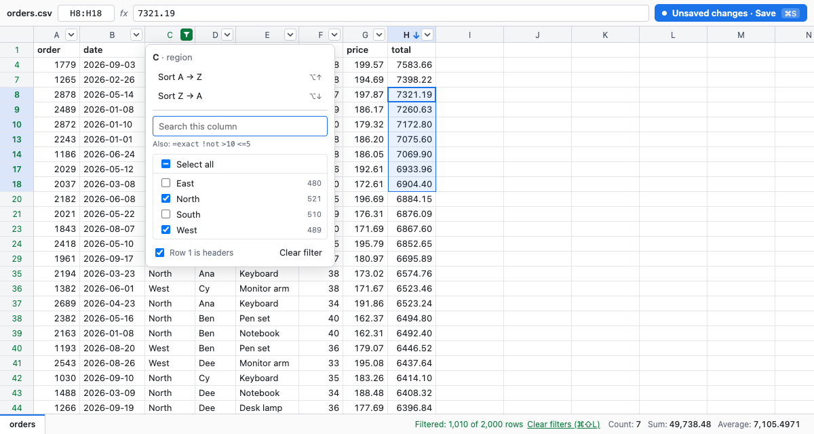

<div align="center">
<pre>
 ██████╗ ██████╗ ██╗██████╗
██╔════╝ ██╔══██╗██║██╔══██╗
██║  ███╗██████╔╝██║██║  ██║
██║   ██║██╔══██╗██║██║  ██║
╚██████╔╝██║  ██║██║██████╔╝
 ╚═════╝ ╚═╝  ╚═╝╚═╝╚═════╝

a quick peek · v0.1.4 / open a CSV or Excel file in your browser
────────────────────────────────────────────────────────────────
</pre>
</div>

Pop open a CSV or Excel file, check it, fix it, save it, close it. No spreadsheet app needed.

```sh
grid orders.csv
```

grid opens the file in a spreadsheet in your browser, with Excel's keyboard shortcuts, sorting, filtering and formulas. Press ⌘S and it writes straight back to the original file, in its original format. Press Ctrl+C in the terminal when you're done. It's a single small program that runs entirely on your computer: no install wizard, no account, and your files never leave your machine.



## Install

### macOS

Apple Silicon (M1 and later):

```sh
curl -L https://github.com/g-leatherwood/grid/releases/latest/download/grid_darwin_arm64.tar.gz | tar xz grid
sudo mv grid /usr/local/bin/
```

Intel Macs: use `grid_darwin_amd64.tar.gz` instead.

If you download the file with a browser instead of `curl`, macOS will refuse to open it because it isn't signed. Clear that once with `xattr -d com.apple.quarantine grid`.

### Linux

```sh
curl -L https://github.com/g-leatherwood/grid/releases/latest/download/grid_linux_amd64.tar.gz | tar xz grid
sudo mv grid /usr/local/bin/
```

On ARM machines, use `grid_linux_arm64.tar.gz`.

### Windows

Download `grid_windows_amd64.zip` from the [latest release](https://github.com/g-leatherwood/grid/releases/latest), unzip it, and run `grid.exe yourfile.csv` from PowerShell or Command Prompt. To run it from anywhere, put `grid.exe` in a folder that's on your `PATH`.

### With Go

If you have Go 1.25 or later:

```sh
go install github.com/g-leatherwood/grid@latest
```

## Use

```sh
grid orders.csv        # CSV, TSV, or .txt with commas, semicolons, tabs or pipes
grid budget.xlsx       # Excel (.xlsx, .xlsm), all sheets
grid notes.csv         # doesn't exist yet? it's created when you save
```

grid opens the file in your default browser and keeps running in the terminal, where it prints its logo and a short startup log — the file it read, the address it's serving on, and a `READY` line — then waits. The labels are colored in a terminal and plain when the output is piped to a file.

- **Save:** press ⌘S (Ctrl+S on Windows and Linux). While you have unsaved changes, the button in the top right turns blue and reads "Unsaved changes · Save".
- **Quit:** press Ctrl+C in the terminal, and the browser tab closes. If the browser won't let a page close its own tab, the tab says grid has quit instead. If you have unsaved changes, grid warns you and waits for a second Ctrl+C.

| Flag | What it does |
| --- | --- |
| `-port N` | Use port N instead of a random free one |
| `-no-open` | Print the address instead of opening a browser |
| `-version` | Print the version |

## Keyboard

The keys follow Excel. On Windows and Linux, use Ctrl for ⌘ and Alt for ⌥.

**Moving and selecting**

| Keys | Action |
| --- | --- |
| Arrows, Tab, Enter (add Shift to go back) | Move |
| ⌘ + arrow | Jump to the edge of the data |
| Shift + arrows, Shift + click, drag | Select a range |
| ⌘A, Shift+Space, Ctrl+Space | Select all, the row, the column |
| ⌘G | Go to a cell, row, column or header (see below) |

**Editing**

| Keys | Action |
| --- | --- |
| Start typing | Replace the cell |
| F2 or double-click | Edit the cell, keeping what's there |
| ⌥Enter | New line inside a cell |
| Esc | Cancel the edit |
| Delete or Backspace | Clear the selected cells |
| ⌘C, ⌘X, ⌘V | Copy, cut and paste, including to and from Excel and Google Sheets |
| ⌘D, ⌘R | Fill down, fill right |
| ⌘Z, ⌘⇧Z | Undo, redo |
| ⌘S | Save |

**Sorting, filtering and finding**

| Keys | Action |
| --- | --- |
| ⌥↓ or ⌘⇧F | Open the column's sort & filter menu |
| ⌥↓ then ⌥↓ | Sort the column Z → A (largest first) |
| ⌥↓ then ⌥↑ | Sort the column A → Z (smallest first) |
| ⌘⇧L | Clear all filters |
| ⌘F | Find anywhere in the sheet (Enter for next, Shift+Enter for previous) |

## Sorting and filtering

Every column with data has a button on its header that opens its sort & filter menu. You can also press ⌥↓ on any cell.

- **Sort** A → Z or Z → A, or smallest to largest for columns of numbers. Numbers, currency and dates sort by value. Blank cells always go last. Row 1 stays on top as headers; you can turn that off in the menu. Sorting rearranges the rows in the file when you save, and ⌘Z undoes it.
- **Search** the column by typing in the menu's search box. Rows filter as you type:

  | Type | Shows rows where the column |
  | --- | --- |
  | `north` | contains "north" (any case) |
  | `=North` | is exactly "North" |
  | `!north` | doesn't contain "north" |
  | `!=North` or `<>North` | is anything but "North" |
  | `>10`, `>=10`, `<0`, `<=5` | is a number in that range (`$1,200` counts as 1200) |

- **Pick values** from the list under the search box, which shows each value with its count. Untick a value to hide its rows. Press ↓ from the search box to move into the list, and Space to tick or untick.

Filters on several columns combine. Filtered columns and their row numbers turn green, and the bar at the bottom shows how many rows are showing. Filters only change what you see; they aren't saved to the file.

## Also

- Right-click a cell or header to insert or delete rows and columns, sort, or filter.
- Drag the edge of a column header to resize the column. Double-click the edge to fit it to its contents.
- Press ⌘G, or click the box at the top left, to jump somewhere. Type a cell or range (`B12`, `A1:D20`), a row (`12`), a column (`AA`), or part of a column's header (`email`), then press Enter. A column or header keeps you on the same row. Letters like `AB` go to that column unless a header is named exactly that; other text goes to the first column, from the left, whose header contains it.
- Select some cells to see their count, sum and average at the bottom right.
- grid works out what kind of data each column holds — text, number, currency, percent, date, yes/no, or mixed. Hover a column header, or open its sort & filter menu, to see the type and how many values fit. A type needs 80% of a column's non-blank cells; numbers, currency and percents together count as numbers. It's only a label and doesn't change your file.
- Big files stay fast: only the cells on screen are drawn, and tens of thousands of rows scroll smoothly.
- Light and dark mode follow your system setting.

## How it treats your files

- **CSV files** keep their delimiter (comma, semicolon, tab or pipe), line endings and UTF-8 BOM. When saving, grid pads every row to the same number of columns and drops empty rows at the end.
- **Excel files** keep their formatting, number formats, other sheets, and anything grid doesn't display. Formulas recalculate as you edit, including across sheets. When you insert rows, sort, or fill, references shift the way they do in Excel.
- **Saving is safe:** grid writes a temporary file and swaps it in, so a crash can't leave you with half a file. If something else changed the file while you had it open, grid asks before overwriting.
- **Private:** grid only accepts connections from your own computer, and each run uses a random key that other web pages can't see. Nothing is uploaded anywhere.

## Limits

- Cell styling (bold, colors, borders) is kept in Excel files but not shown, and you can't change it.
- No charts, merged cells, freezing panes, or adding and renaming sheets.
- Formulas are computed with [excelize](https://github.com/xuri/excelize), which supports most common functions. If it can't compute one, grid shows the value Excel last saved, and Excel recalculates it when you next open the file.
- Sorting covers every row below the header. You can't sort a selected range on its own.
- Old `.xls` files aren't supported. Save them as `.xlsx` first.

## Build from source

With Go 1.25 or later:

```sh
git clone https://github.com/g-leatherwood/grid
cd grid
go build .
```

To work on grid, see [CONTRIBUTING.md](CONTRIBUTING.md).

## License

[MIT](LICENSE)
